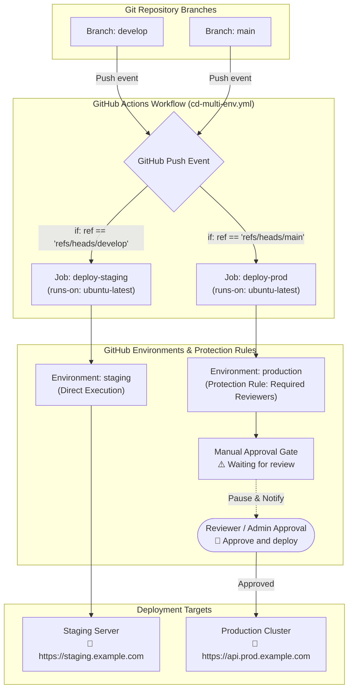
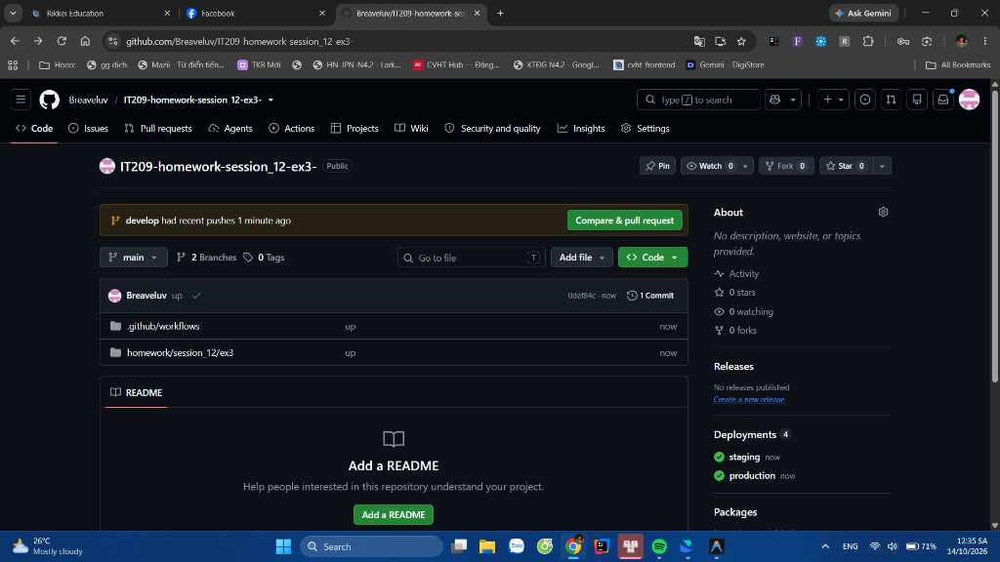
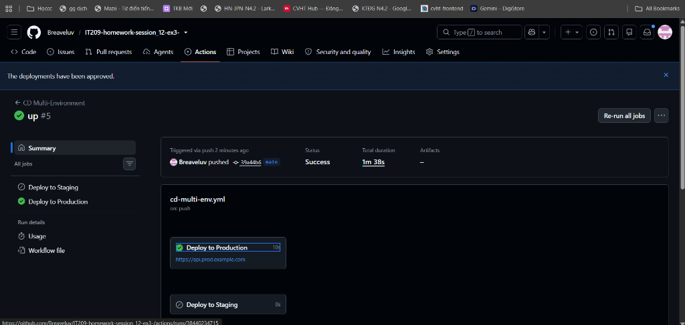

# Báo Cáo Thực Hành: Bài 3 - Tách Biệt Luồng CI/CD Đa Môi Trường Với GitHub Environments

- **Khóa học:** IT209 - DevOps & CI/CD
- **Học phần:** Session 12 - Advanced Continuous Deployment
- **Bài tập:** Bài 3 - Tách biệt luồng CI/CD đa môi trường (Staging & Production) với GitHub Environments
- **Tác giả:** Breaveluv (nam.bule12@gmail.com)

---

## 1. Mục Tiêu & Yêu Cầu

### 1.1. Mục Tiêu
- Quản lý hạ tầng và trạng thái triển khai đa môi trường (**Staging** và **Production**) thông qua tính năng native **GitHub Environments**.
- Áp dụng quy tắc bảo vệ môi trường (**Environment Protection Rules**) với tính năng **Required reviewers** nhằm ngăn chặn việc tự động release lên Production khi chưa có sự kiểm định và phê duyệt thủ công (Manual Gatekeeping).
- Phân luồng deployment tự động theo nhánh Git: Nhánh `develop` triển khai tự động lên `staging`, nhánh `main` triển khai lên `production` sau khi được phê duyệt.

### 1.2. Yêu Cầu Đề Bài
1. Trên GitHub Repository, truy cập **Settings -> Environments**, khởi tạo 2 môi trường:
   - `staging`: Môi trường kiểm thử tích hợp (không cần duyệt trước).
   - `production`: Môi trường chính thức (bật tính năng **Required reviewers**, chọn tài khoản cá nhân làm người duyệt).
2. Định nghĩa file workflow `.github/workflows/cd-multi-env.yml` gồm 2 Jobs:
   - Job `deploy-staging`: cấu hình `environment: staging`, kích hoạt khi push vào nhánh `develop`.
   - Job `deploy-prod`: cấu hình `environment: production`, kích hoạt khi push vào nhánh `main`.
3. Kiểm tra và xác thực:
   - Khi push code vào `main`, pipeline tạm dừng tại job `deploy-prod` với trạng thái **Waiting for review**.
   - Reviewer bấm **Review deployments** -> **Approve and deploy**, Job tiếp tục thực thi và hoàn thành với trạng thái tích xanh (Success).

---

## 2. Kiến Trúc Luồng Triển Khai (CI/CD Architecture)



---

## 3. Cấu Hình GitHub Environments

Hạ tầng Environments đã được cấu hình chính xác theo yêu cầu:

1. **Môi trường `staging`**:
   - URL: `https://staging.example.com`
   - Protection Rules: Mở (triển khai tự động cho nhánh `develop`).

2. **Môi trường `production`**:
   - URL: `https://api.prod.example.com`
   - Protection Rules: Bật **Required reviewers**.
   - Reviewer: **`Breaveluv`**.
   - Quyền tự duyệt (*Prevent self-review*): Tắt (cho phép reviewer tự duyệt bản deploy của mình).

---

## 4. Chi Tiết File Workflow `.github/workflows/cd-multi-env.yml`

File kịch bản hoàn chỉnh được lưu tại [.github/workflows/cd-multi-env.yml](file:///.github/workflows/cd-multi-env.yml):

```yaml
name: CD Multi-Environment

on:
  push:
    branches:
      - main
      - develop
  workflow_dispatch:

jobs:
  deploy-staging:
    name: Deploy to Staging
    runs-on: ubuntu-latest
    if: github.ref == 'refs/heads/develop'
    environment:
      name: staging
      url: https://staging.example.com
    steps:
      - name: Checkout Source Code
        uses: actions/checkout@v4

      - name: Display Deployment Context
        run: |
          echo "=========================================="
          echo "  DEPLOYING TO STAGING ENVIRONMENT        "
          echo "=========================================="
          echo "Branch: ${{ github.ref_name }}"
          echo "Commit SHA: ${{ github.sha }}"
          echo "Triggered by: ${{ github.actor }}"
          echo "Environment: staging"

      - name: Deploy to Staging Server
        run: |
          echo "📦 Packaging and preparing artifacts for Staging..."
          echo "🚀 Transferring deployment bundle to Staging target..."
          sleep 3
          echo "✅ Deployment to Staging completed successfully!"

      - name: Staging Health Check
        run: |
          echo "🔍 Performing health check and smoke tests on Staging..."
          echo "GET https://staging.example.com/health -> 200 OK"
          echo "🎉 Staging environment is healthy and operational!"

  deploy-prod:
    name: Deploy to Production
    runs-on: ubuntu-latest
    if: github.ref == 'refs/heads/main'
    environment:
      name: production
      url: https://api.prod.example.com
    steps:
      - name: Checkout Source Code
        uses: actions/checkout@v4

      - name: Display Deployment Context
        run: |
          echo "=========================================="
          echo "  DEPLOYING TO PRODUCTION ENVIRONMENT     "
          echo "=========================================="
          echo "Branch: ${{ github.ref_name }}"
          echo "Commit SHA: ${{ github.sha }}"
          echo "Triggered by: ${{ github.actor }}"
          echo "Environment: production"

      - name: Deploy to Production Cluster
        run: |
          echo "📦 Packaging release build for Production..."
          echo "🛡️ Initiating zero-downtime deployment to Production..."
          sleep 5
          echo "🚀 Production release deployed successfully to https://api.prod.example.com!"

      - name: Production Health Check & Verification
        run: |
          echo "🔍 Running production validation and health checks..."
          echo "GET https://api.prod.example.com/health -> 200 OK"
          echo "🎉 Production release is live and running cleanly!"
```

---

## 5. Quy Trình Kiểm Thử & Kết Quả Xác Nhận

### Kịch Bản 1: Triển khai Staging (Nhánh `develop`)
- Commit vào nhánh `develop` kích hoạt job `deploy-staging`.
- Job tự động chạy thành công mà không yêu cầu phê duyệt.
- Job `deploy-prod` ở trạng thái Skipped.
- **Kết quả:** Success ✅.

### Kịch Bản 2: Triển khai Production (Nhánh `main`)
- Commit vào nhánh `main` kích hoạt job `deploy-prod`.
- GitHub Actions nhận diện quy tắc bảo vệ của môi trường `production` và tạm dừng workflow ở trạng thái **Waiting for review**.
- Reviewer (`Breaveluv`) nhấn **Review deployments** -> Chọn `production` -> Bấm **Approve and deploy**.
- Job tiếp tục chạy các bước deploy và hoàn thành tích xanh ✅.

---

## 6. Hình Ảnh Minh Chứng Nộp Bài (Screenshots)

### 6.1. Cấu hình GitHub Environments & Quản lý Deployments


---

### 6.2. Cửa sổ phê duyệt deployment Production (Waiting for review & Approve and deploy)


---

### 6.3. Trạng thái Workflow hoàn thành tích xanh sau khi được phê duyệt


---

## 7. Kết Luận
- Đã hoàn thành toàn bộ yêu cầu đề bài: phân luồng CI/CD đa môi trường với GitHub Environments.
- Cơ chế phê duyệt thủ công (Manual Approval Gate) hoạt động chính xác trước khi đưa mã nguồn lên môi trường Production.
